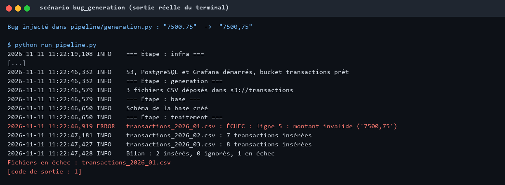
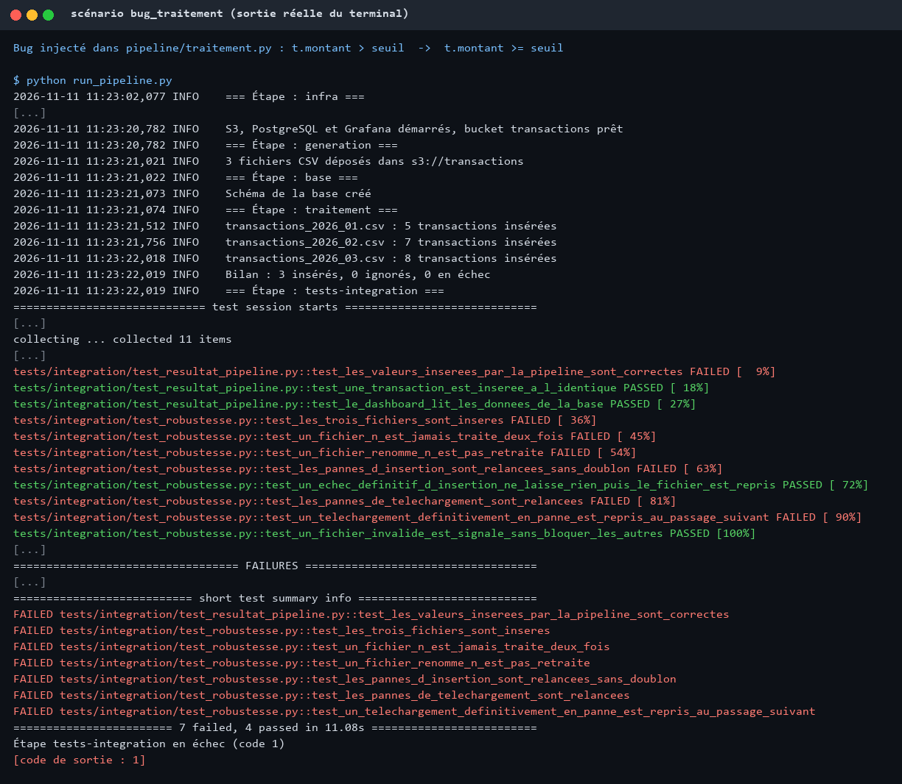
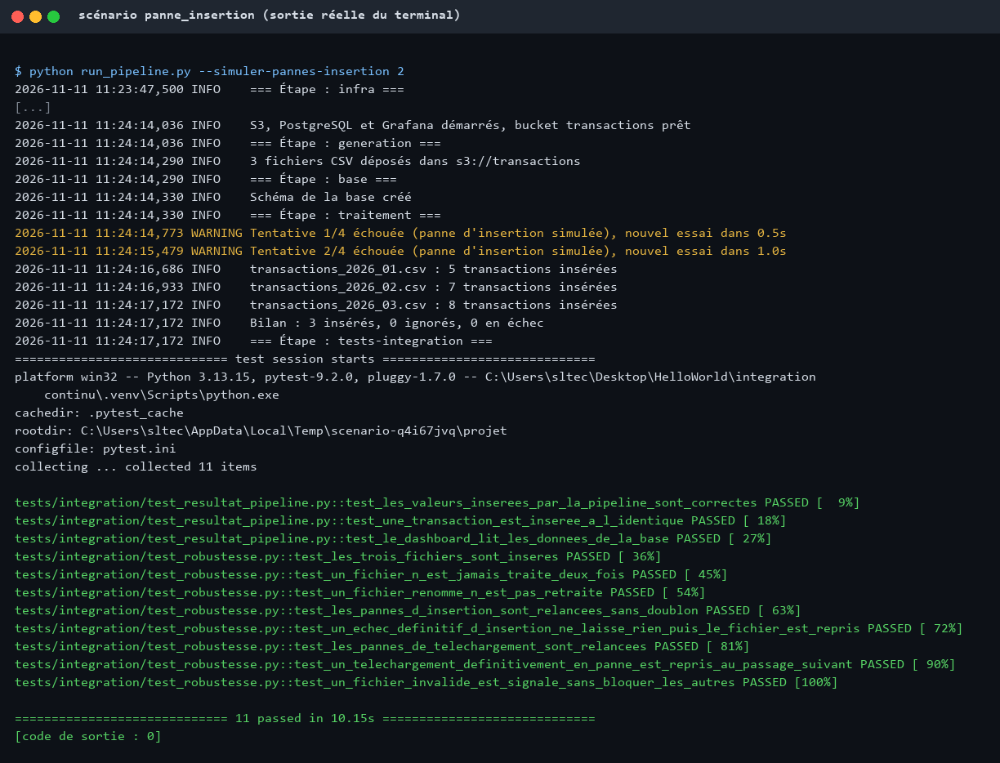
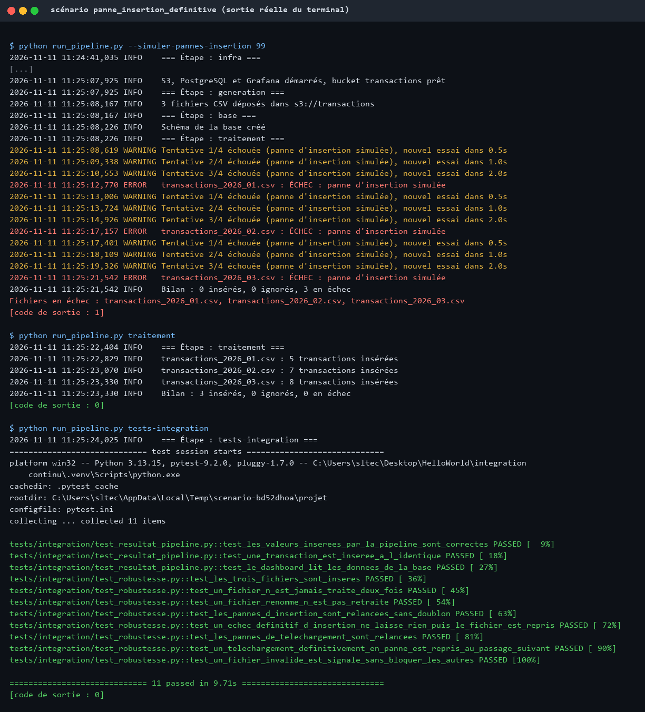
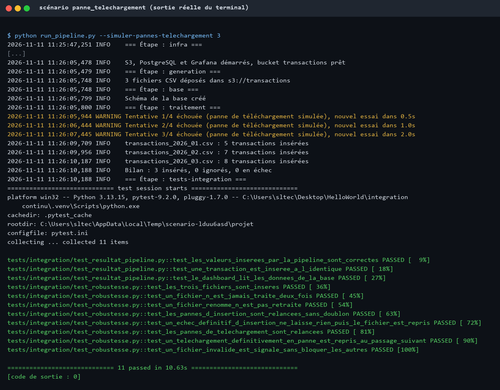

# Mini-projet Data Engineering : intégration continue d'une pipeline data

La pipeline part de fichiers CSV de transactions financières stockés dans un S3 local, calcule des agrégats, les insère dans PostgreSQL et les expose dans un dashboard Grafana. L'intégration continue vérifie à chaque push que les valeurs en base sont correctes.

```
Génération CSV ──> S3 (SeaweedFS) ──> Chargement ──> Traitement ──> PostgreSQL ──> Grafana
                                      et validation  (fonctions pures)
```

## Lancer le projet

Prérequis : Python 3.13 et Docker.

```bash
python -m venv .venv
source .venv/bin/activate      # Windows : .venv\Scripts\activate
pip install -r requirements-dev.txt

python run_pipeline.py         # démarre l'infrastructure et exécute toute la pipeline
pytest tests/unitaires         # tests unitaires, sans Docker
```

Une étape peut être lancée seule : `python run_pipeline.py infra`, `generation`, `base`, `traitement` ou `tests-integration`.

Le dashboard est disponible sur <http://localhost:3001> (`admin` / `admin`). Pour tout arrêter et effacer les données : `docker compose down -v`.

## Réalisation du sujet

### Niveau 1

| # | Demande | Réalisation |
|---|---------|-------------|
| 1 | Générer plusieurs CSV de 5 à 10 transactions, non aléatoires | [pipeline/generation.py](pipeline/generation.py) : 3 fichiers de 5, 7 et 8 transactions fixes |
| 2 | Charger et traiter, avec des fonctions de traitement pures | Chargement : [pipeline/chargement.py](pipeline/chargement.py). Traitement pur : [pipeline/traitement.py](pipeline/traitement.py) |
| 3 | Concevoir la base et insérer les résultats | [sql/schema.sql](sql/schema.sql) et [pipeline/base_donnees.py](pipeline/base_donnees.py) |
| 4 | Pipeline complète | [run_pipeline.py](run_pipeline.py) en local, [.github/workflows/ci.yml](.github/workflows/ci.yml) en CI |
| 5 | Test d'intégration des valeurs insérées | [tests/integration/test_resultat_pipeline.py](tests/integration/test_resultat_pipeline.py), comparé à des totaux calculés à la main |
| 6 | Scénario d'échec avec captures | [Scénarios](#scénarios-de-panne) ci-dessous |
| 7 | Simuler un bug d'insertion et proposer un retry | [pipeline/retry.py](pipeline/retry.py), option `--simuler-pannes-insertion N` |
| Remarque | Ne jamais traiter deux fois un fichier | [Idempotence](#idempotence) ci-dessous |

Le sujet ne liste pas de colonne de montant alors que les traitements en ont besoin : une colonne `montant` a été ajoutée au format CSV.

Le schéma de la base est créé avant le traitement, et non après comme dans l'ordre du sujet, car le contrôle des fichiers déjà traités a besoin de la base.

### Niveau 2

| # | Demande | Réalisation |
|---|---------|-------------|
| 1 | Stocker les CSV dans un S3 local | SeaweedFS, dans [docker-compose.yml](docker-compose.yml) |
| 2 | Déposer les CSV dans le S3 lancé en début de pipeline | Étapes `infra` puis `generation` |
| 3 | Récupérer les données depuis le S3 | [pipeline/stockage.py](pipeline/stockage.py) |
| 4 | Retry si la récupération échoue | `telecharger` dans [pipeline/stockage.py](pipeline/stockage.py), option `--simuler-pannes-telechargement N` |

### Niveau 3 : déploiement continu avec Docker

L'amélioration retenue est la pipeline CD. Les options OCR, small language model et Terraform ne sont pas implémentées.

| Élément | Réalisation |
|---------|-------------|
| S3, base de données et service de traitement | [docker-compose.prod.yml](docker-compose.prod.yml) |
| Lancement régulier du traitement | [pipeline/planificateur.py](pipeline/planificateur.py), un cycle toutes les 30 s par défaut |
| Pipeline CD | [.github/workflows/cd.yml](.github/workflows/cd.yml) |
| Script de déploiement | [deploy/deploy.sh](deploy/deploy.sh) |
| Test de bout en bout de la stack | [tests/e2e/test_stack_production.py](tests/e2e/test_stack_production.py) |

La CD se déclenche après une CI réussie sur `main`. Elle déploie d'abord la stack de production sur le runner et la teste, publie ensuite l'image sur GitHub Container Registry, puis déploie sur la machine virtuelle par SSH.

Configuration requise :

- une machine virtuelle avec Docker ;
- un environnement GitHub `production` avec les secrets `VM_HOST`, `VM_USER`, `VM_SSH_KEY`, `VM_KNOWN_HOSTS`, `POSTGRES_PASSWORD`, `S3_ACCESS_KEY`, `S3_SECRET_KEY` et `GRAFANA_PASSWORD`.

Le mot de passe PostgreSQL entre dans une URL de connexion : il ne doit contenir que des lettres et des chiffres.

## Modèle de données

| Table | Contenu |
|-------|---------|
| `fichier_traite` | Fichiers déjà insérés, identifiés par leur empreinte SHA-256 |
| `transaction_financiere` | Transactions et leur flag (montant strictement supérieur à 5000) |
| `total_envoye_par_iban` | Somme envoyée par IBAN d'origine |
| `total_envoye_par_banque` | Somme envoyée par banque source |
| `total_recu_par_iban` | Somme reçue par IBAN destinataire |

Les totaux s'accumulent d'un fichier à l'autre.

## Idempotence

Un fichier est identifié par l'empreinte SHA-256 de son contenu : un fichier renommé est donc reconnu.

L'enregistrement du fichier et l'insertion de ses données se font dans une seule transaction SQL. Si l'insertion échoue, rien n'est conservé et le fichier sera repris. Si elle réussit, la contrainte `UNIQUE` sur l'empreinte empêche toute seconde insertion, même lors d'un retry ou avec deux exécutions simultanées.

## Reprise sur panne

Les erreurs transitoires (base ou S3 momentanément indisponibles) sont relancées jusqu'à 4 fois, avec un délai doublé à chaque essai. Les erreurs définitives, comme un CSV invalide, ne sont pas relancées. Un fichier en échec n'empêche pas de traiter les suivants, mais la pipeline se termine alors en erreur.

## Scénarios de panne

```bash
python scenarios/scenario.py bug_generation
```

Chaque scénario travaille sur une copie temporaire du code et efface l'environnement Docker local (`docker compose down -v`). Les captures ci-dessous sont des rendus PNG de la sortie réelle du terminal ; le journal complet se trouve à côté, dans [captures/](captures/).

| Scénario | Ce qui est simulé | Résultat attendu |
|----------|-------------------|------------------|
| `bug_generation` | Un montant écrit `7500,75` au lieu de `7500.75` | Le fichier est rejeté, la pipeline échoue à l'étape `traitement` |
| `bug_traitement` | Le flag utilise `>=` au lieu de `>` | L'insertion réussit, mais le test d'intégration détecte un flag en trop |
| `panne_insertion` | Les 2 premières insertions échouent | Le retry réussit, aucun doublon |
| `panne_insertion_definitive` | Toutes les insertions échouent | Rien n'est conservé, la pipeline échoue, puis une nouvelle exécution reprend les fichiers |
| `panne_telechargement` | Les 3 premiers téléchargements échouent | Le retry réussit |

### Bug dans la génération



### Bug dans le traitement



### Panne d'insertion avec retry



### Panne d'insertion définitive puis reprise



### Panne de téléchargement avec retry



Pour voir un échec dans GitHub Actions, lancer manuellement le workflow **CI** en choisissant un bug à injecter. Les tests unitaires le détectent alors avant l'étape d'intégration.

## Tests

| Dossier | Portée | Nombre |
|---------|--------|--------|
| `tests/unitaires` | Traitement, validation, retry, erreurs S3 | 24 |
| `tests/integration` | Vrais S3, PostgreSQL et Grafana | 11 |
| `tests/e2e` | Stack de production déployée | 1 |
